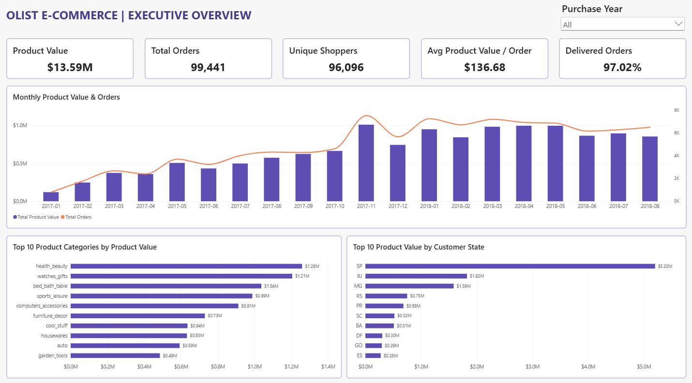
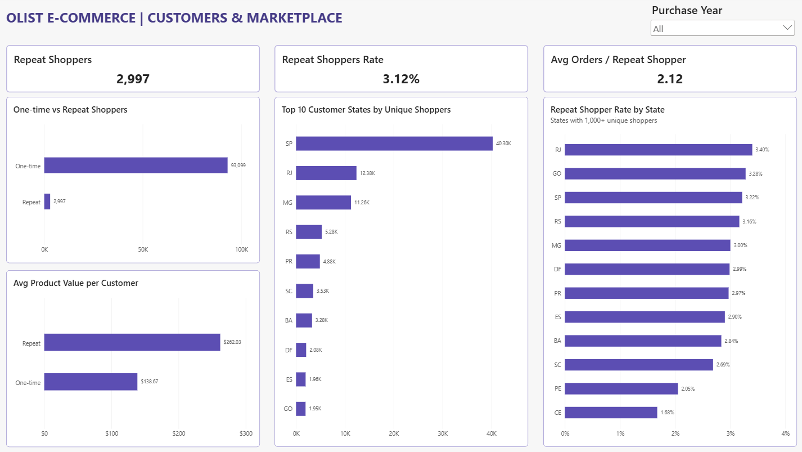
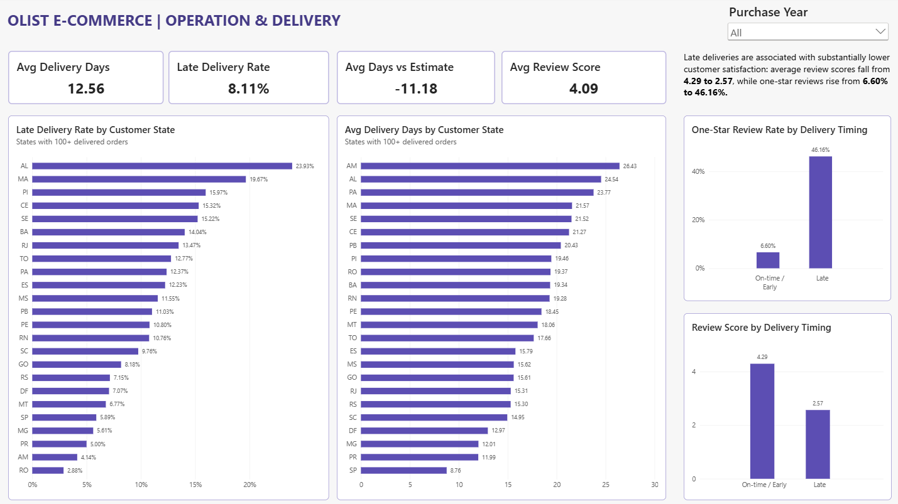

# Olist E-Commerce SQL & Business Intelligence Analytics

An end-to-end SQL and Business Intelligence project analyzing the Brazilian Olist e-commerce dataset using **PostgreSQL, SQL, Power BI, data modeling, and DAX**.

The project transforms raw marketplace data into a validated analytics layer and an interactive three-page Power BI report covering business performance, customer behaviour, marketplace geography, delivery operations, and customer satisfaction.

---

## Project Overview

The Olist dataset contains transactional data from a Brazilian e-commerce marketplace, including customers, orders, products, sellers, payments, reviews, delivery information, and geolocation data.

The objective of this project was to build a complete analytics workflow:

**Raw CSV Data → PostgreSQL → Data Validation → Analytics Layer → SQL Business Analysis → Advanced Analysis → Power BI Data Model → Interactive Dashboard**

The analysis focuses on four main business areas:

- Marketplace and sales performance
- Customer behaviour and repeat purchasing
- Product and geographic performance
- Delivery operations and customer satisfaction

---

## Tools & Technologies

- PostgreSQL
- SQL
- Power BI
- DAX
- Data Modeling
- Data Validation
- Business Intelligence
- Data Visualization

---

## Dataset

The project uses the public **Brazilian E-Commerce Public Dataset by Olist**.

The source data consists of nine CSV files covering:

- Customers
- Orders
- Order items
- Products
- Sellers
- Payments
- Reviews
- Geolocation
- Product category translations

### Raw Data Volume

| Dataset | Rows |
|---|---:|
| Geolocation | 1,000,163 |
| Order Items | 112,650 |
| Payments | 103,886 |
| Customers | 99,441 |
| Orders | 99,441 |
| Reviews | 99,224 |
| Products | 32,951 |
| Sellers | 3,095 |
| Product Category Translation | 71 |

The dataset contains **96,096 unique shoppers**.

### Getting the Data

The raw CSV files are not included in this repository to keep it lightweight and avoid redistributing a third-party dataset.

Download the **Brazilian E-Commerce Public Dataset by Olist** from Kaggle: <https://www.kaggle.com/datasets/olistbr/brazilian-ecommerce>

Place the nine CSV files in a local `data/` folder (or update the paths in `01_SQL/03_data_import.sql`) before running the SQL scripts.

---

## Data Engineering & Validation

The raw CSV files were imported into PostgreSQL and validated before analysis.

Validation checks included:

- Primary entity counts
- Missing delivery dates
- Unexpected delivery dates
- Orders without items
- Orders without payments
- Orders without reviews
- Multiple payments per order
- Multiple items per order
- Multiple reviews per order
- Product weight anomalies
- Payment anomalies
- Shopper identity validation

Several important data-quality conditions were identified, including:

- 775 orders without order items
- 1 order without payment records
- 768 orders without reviews
- 547 orders with multiple review records
- 2,961 orders with multiple payment records
- 9,803 orders with multiple items

These checks informed the grain and join strategy used throughout the analytics layer.

---

## Analytics Layer

A dedicated PostgreSQL analytics schema was created rather than performing business analysis directly on the raw tables.

The analytics layer includes:

### Dimensions

- `dim_customers`
- `dim_products`
- `dim_sellers`
- `dim_geolocation`

### Facts

- `fact_orders`
- `fact_order_items`
- `fact_payments`
- `fact_order_financials`
- `fact_reviews`

The model separates order-, item-, payment-, and review-level facts to prevent incorrect aggregation caused by many-to-many joins.

### Financial Reconciliation

Item and payment totals were aggregated independently at order level before comparison to prevent join fan-out.

Across comparable orders:

- **98,665** orders could be compared
- **98,362** matched within R$0.01
- **303** differed by more than R$0.01

Because the dataset does not provide enough information to establish the cause of those differences, item-based product values and payment values were retained as separate measures rather than assuming the differences represented discounts, refunds, or another specific adjustment.

---

## SQL Business Analysis

Ten business questions were investigated using SQL.

### 1. Marketplace Overview

The dataset contains:

- **99,441 orders**
- **96,478 delivered orders**
- **96,096 unique shoppers**
- **112,650 order items**
- **32,951 products sold**
- **3,095 active sellers**

Total product value:

**R$13.59M**

Total freight value:

**R$2.25M**

Total item value including freight:

**R$15.84M**

Recorded payment value:

**R$16.01M**

Delivered orders represented approximately **97.02%** of all orders.

---

### 2. Monthly Marketplace Performance

The primary continuous analytical period was:

**January 2017 – August 2018**

Marketplace activity expanded substantially during this period, although monthly performance was not uniformly increasing.

November 2017 was particularly strong, reaching approximately:

**R$1.01M in product value across 7,451 orders**

The analysis separates product value from freight and payment value to avoid treating different financial concepts as interchangeable revenue measures.

---

### 3. Leading Product Categories

The highest product-value categories included:

| Product Category | Product Value |
|---|---:|
| Health & Beauty | R$1.26M |
| Watches & Gifts | R$1.21M |
| Bed, Bath & Table | R$1.04M |
| Sports & Leisure | R$0.99M |
| Computers & Accessories | R$0.91M |

The five leading categories accounted for approximately **39.74% of total product value**.

---

### 4. Repeat Shopping Behaviour

Most observed shoppers purchased only once.

| Shopper Segment | Shoppers | Share |
|---|---:|---:|
| One-time | 93,099 | 96.88% |
| 2–3 Orders | 2,948 | 3.07% |
| 4+ Orders | 49 | 0.05% |

Overall:

**2,997 shoppers (3.12%) placed more than one order.**

This is an observed repeat-shopping measure within the dataset and should not be interpreted as a formal customer retention rate.

---

### 5. Geographic Marketplace Concentration

São Paulo was the largest customer market by a substantial margin.

Product value by leading states included:

- São Paulo — **R$5.20M**
- Rio de Janeiro — **R$1.82M**
- Minas Gerais — **R$1.59M**

Together, these three states represented approximately:

**63.36% of total product value**

---

### 6. Seller Concentration

Marketplace product value was relatively dispersed across sellers.

The largest seller represented approximately:

**1.69% of product value**

The top 10 sellers represented approximately:

**13.15%**

The top 20 represented approximately:

**21.09%**

This indicates that marketplace activity was not dominated by only a handful of sellers.

---

### 7. Delivery Timing & Customer Satisfaction

Delivery timing showed a substantial association with review scores.

| Delivery Timing | Avg Review Score | One-Star Rate | Five-Star Rate |
|---|---:|---:|---:|
| On-time / Early | 4.29 | 6.60% | 62.43% |
| Late | 2.57 | 46.19% | 22.20% |

Late deliveries were associated with an average review-score difference of approximately:

**−1.72 points**

The one-star review rate among late deliveries was approximately **7×** the rate observed among on-time/early deliveries.

This analysis demonstrates association, not causality.

---

### 8. Regional Delivery Performance

Delivery performance varied considerably across customer states.

Among states with at least 100 delivered orders, some of the highest late-delivery rates were:

| State | Late Delivery Rate |
|---|---:|
| AL | 23.93% |
| MA | 19.67% |
| PI | 15.97% |
| CE | 15.32% |
| SE | 15.22% |

By comparison:

- SP — **5.89%**
- MG — **5.62%**
- PR — **5.00%**

The analysis uses minimum-volume thresholds to reduce the risk of drawing conclusions from very small state-level samples.

---

### 9. Payment Behaviour

Credit cards represented the majority of recorded payment value.

| Payment Type | Share of Payment Value |
|---|---:|
| Credit Card | 78.34% |
| Boleto | 17.92% |
| Voucher | 2.37% |
| Debit Card | 1.36% |

Credit-card payments also used approximately **3.51 installments per payment record on average**.

---

### 10. Customer Value Segmentation

Among customers represented in item-level activity:

| Segment | Avg Product Value / Customer | Avg Orders | Avg Items |
|---|---:|---:|---:|
| One-time | R$138.67 | 1.00 | 1.14 |
| Repeat | R$262.03 | 2.11 | 2.57 |

Repeat shoppers generated approximately **1.89× the product value per customer** observed among one-time shoppers.

This is an observed product-value comparison within the available transaction history, not a formal lifetime-value calculation.

---

## Cohort Analysis

A monthly cohort analysis was developed in SQL to examine repeat purchasing over time.

The final cohort matrix distinguishes between:

- **0%** — the cohort was observable but no repeat activity occurred
- **NULL** — the future cohort period had not yet become observable

This prevents future periods from being incorrectly represented as zero retention.

The resulting cohort matrix is available in:

`03_Results/cohort_retention_matrix.csv`

---

# Power BI Dashboard

A three-page interactive Power BI report was developed using the PostgreSQL analytics layer.

A dedicated date dimension and controlled star-schema relationships were used to support consistent filtering across the report.

---

## Page 1 — Executive Overview



The Executive Overview provides a high-level view of marketplace scale and performance.

Key KPIs include:

- **R$13.59M** product value
- **99,441** orders
- **96,096** unique shoppers
- **R$136.68** average product value per order
- **97.02%** delivered orders

The page also presents:

- Monthly product value and order trends
- Top 10 product categories
- Top 10 customer states by product value

---

## Page 2 — Customers & Marketplace



This page focuses on customer behaviour and marketplace geography.

Key KPIs include:

- **2,997 repeat shoppers**
- **3.12% repeat shopper rate**
- **2.12 average orders per repeat shopper**

The page compares one-time and repeat shoppers, including the difference in average product value per customer:

**R$138.67 → R$262.03**

It also examines:

- Customer concentration by state
- Repeat shopper rate by state
- State-level repeat behaviour using a minimum shopper-volume threshold

---

## Page 3 — Operations & Delivery



The final page focuses on delivery operations and their relationship with customer satisfaction.

Key operational KPIs:

- **12.56 days** average delivery time
- **8.11%** late delivery rate
- **−11.18 days** average difference versus estimated delivery date
- **4.09 / 5** average review score

The page compares delivery performance geographically and shows the substantial difference in customer satisfaction between on-time/early and late deliveries.

In the Power BI model, late deliveries were associated with:

**Average Review Score: 4.29 → 2.57**

and

**One-Star Review Rate: 6.60% → 46.16%**

The Power BI one-star late-delivery rate uses the report model's review population and therefore differs slightly from the corresponding SQL analysis population (46.19%).

---

## Power BI Data Model

The Power BI model uses controlled relationships rather than automatically generated relationships.

Core model components include:

- Customer dimension
- Product dimension
- Seller dimension
- Date dimension
- Order fact
- Order-item fact
- Review fact
- Order-financial fact

Filters propagate through the order-level model to downstream facts, helping preserve the intended grain of each table.

Disconnected helper tables are used where appropriate for dynamic segmentation and comparison visuals.

---

## Key Business Insights

The analysis highlights several important marketplace patterns:

**Marketplace concentration:** São Paulo dominates marketplace activity, while the top three states account for approximately 63% of product value.

**Low observed repeat purchasing:** Only 3.12% of shoppers placed multiple orders during the observed period.

**Higher value among repeat shoppers:** Repeat shoppers generated approximately 1.89× the product value per customer compared with one-time shoppers.

**Delivery performance varies geographically:** Late-delivery rates differ substantially between customer states.

**Delivery timing and satisfaction are strongly associated:** Late deliveries correspond with considerably lower review scores and substantially higher one-star review rates.

**Marketplace seller activity is dispersed:** The top seller accounts for less than 2% of product value, and the top 20 sellers account for approximately 21%.

---

## Project Structure

```text
Olist E-Commerce SQL & Business Intelligence Analytics/
│
├── 01_SQL/
│   ├── 01_database_setup.sql
│   ├── 02_raw_tables.sql
│   ├── 03_data_import.sql
│   ├── 04_data_validation.sql
│   ├── 05_analytics_layer.sql
│   ├── 06_business_analysis.sql
│   └── 07_advanced_analysis.sql
│
├── 02_PowerBI/
│   ├── Olist E-Commerce powerBI report.pbix
│   └── Theme.json
│
├── 03_Results/
│   ├── 01_executive_overview.png
│   ├── 02_customers_marketplace.png
│   ├── 03_operations_delivery.png
│   └── cohort_retention_matrix.csv
│
└── README.md
```

The raw Olist CSV files are not included — see [Getting the Data](#getting-the-data) above.

---

## Analytical Considerations

Several methodological decisions were made to improve analytical reliability:

- Financial facts were aggregated independently before order-level comparison to avoid join fan-out.
- `customer_unique_id` was used to identify shoppers across multiple orders.
- Product value, freight value, item value, and payment value were kept conceptually separate.
- State-level comparisons use minimum population thresholds where small samples could distort rankings.
- Cohort periods that are not yet observable are represented as `NULL`, not zero.
- Delivery timing and review results are described as associations rather than causal effects.
- Repeat purchasing is not presented as a formal retention or lifetime-value metric.

---

## Skills Demonstrated

This project demonstrates practical experience with:

**SQL & PostgreSQL**
- Relational data analysis
- Multi-table joins
- CTEs
- Aggregations
- Window functions
- Data validation
- Analytical views
- Cohort analysis
- Grain management
- Financial reconciliation

**Power BI & DAX**
- Data modeling
- Date dimensions
- Relationship management
- DAX measures
- Dynamic segmentation
- KPI design
- Interactive filtering
- Business dashboard design
- Stakeholder-focused data visualization

**Analytics**
- Customer segmentation
- Marketplace analysis
- Geographic analysis
- Operational analysis
- Customer satisfaction analysis
- Data-quality assessment
- Business storytelling

---

## Author

**Cyrus Namjoo**

Data Analytics | SQL | Power BI | Python | Machine Learning